# LannPya: illustrated delivery workflow

[Back to the repository](../../README.md) · [Open the live demo](https://lannpya-ai.vercel.app)

Follow an order from the dispatcher to the buyer and rider, then back to the hub for close-out. The 17 supplied screenshots are grouped below in workflow order. Click any image to view it at full size. Names, amounts, dates, and order references in the screenshots are examples; use the details of your own demo order.

**Flow:** Create order → share buyer link → buyer enters phone and confirms location/time → dispatcher resolves any reviews → automatic rider assignment → rider accepts and delivers → cash/parcel handover → dispatcher accepts and closes → complete.

## Before you begin

Open the live demo and use **Fill Demo Credentials** on the Dispatcher or Rider sign-in page. Use separate browser profiles or a private window to test different roles without replacing the dispatcher's session. Add sample orders and buyer details as needed; saved data persists in the connected Supabase database.

If the site, sign-in, or database connection fails on your network, try a VPN and refresh. When a verification-code screen appears, use **123456** or the generated test code shown on that screen. Dispatcher-shared links normally start with the order-reference and phone form.

## 1. Dispatcher: enter the buyer and parcel details

Choose **Create order → Add one order**. Enter the buyer's name, phone number, parcel description, township, street, and any useful landmark or floor details. Keep the buyer phone number available for the customer step.

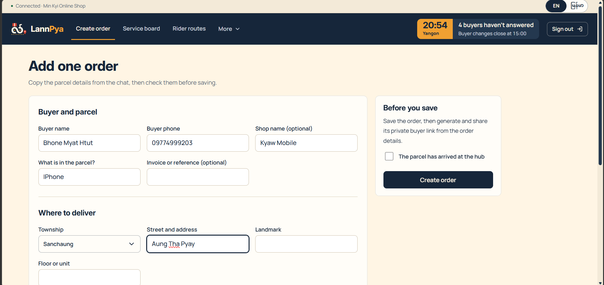

## 2. Dispatcher: set delivery and payment details

Choose the delivery day and time window, payment method, amount to collect, and any delivery notes. Mark the parcel as arrived at the hub only when it has actually arrived. Click **Create order**.

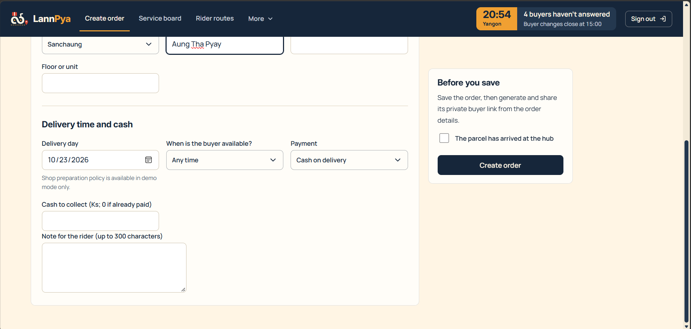

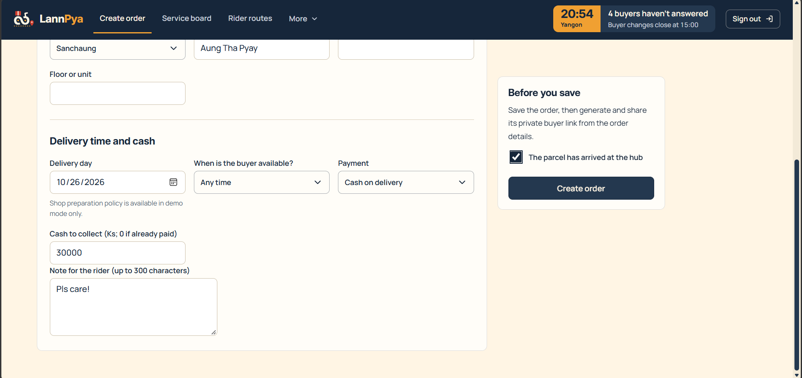

## 3. Dispatcher: check the saved order and share its customer link

Open the saved order. Check its reference, amount, address details, and **Next steps**. In **Buyer link & message**, generate a buyer link if needed, then use **Copy link** or **Copy message for buyer** and send it to the buyer. Creating a link copies it automatically when clipboard access is available; otherwise, copy the displayed URL manually.

The shared URL opens the order-reference and phone page. **See what the buyer sees** opens that same entry page.

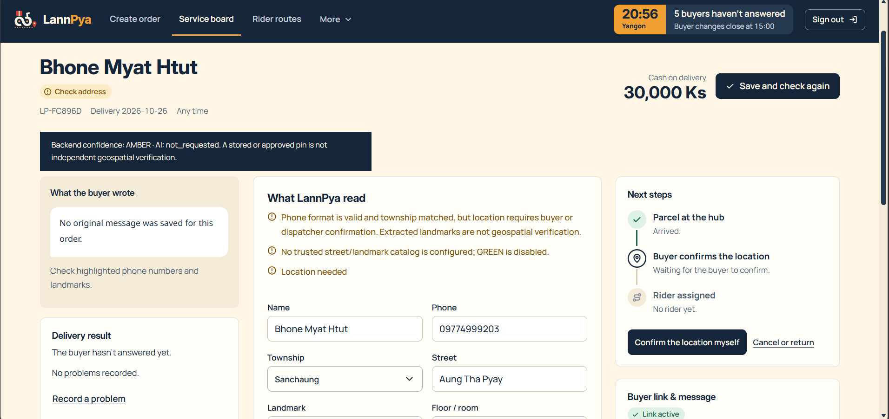

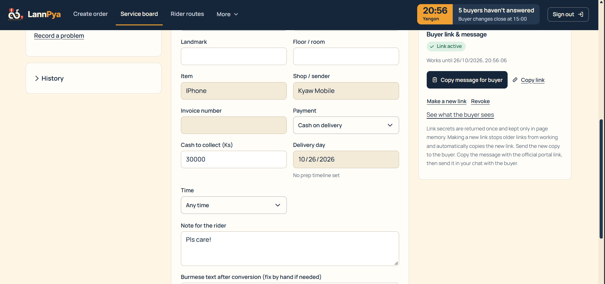

## 4. Buyer: open the delivery using the matching phone number

Open the dispatcher-shared link. The order reference is already filled in. Enter the buyer phone number saved on the order, then click **Open my delivery**. A matching reference and phone number opens that order's delivery edit page.

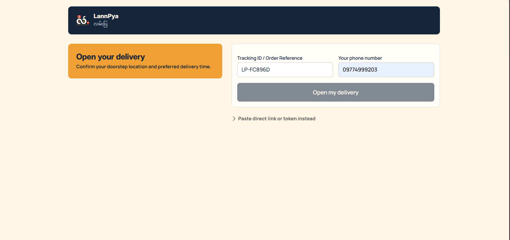

## 5. Buyer: confirm the delivery pin

Check the map and place the pin at the actual delivery destination. You can use **Use my device location** when you are at the destination. Check the address and landmark details before continuing, and acknowledge the pin when the form asks you to.

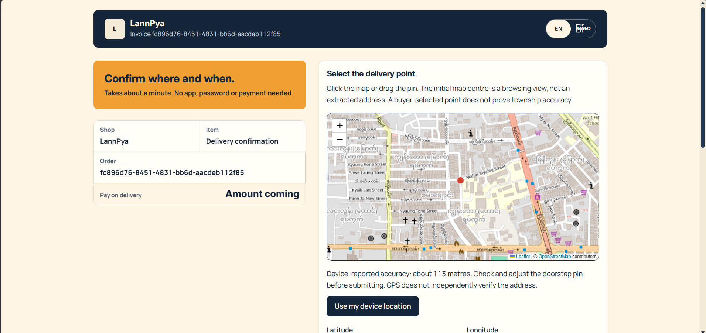

## 6. Buyer: choose the delivery time and submit

Select the requested delivery day and time window, add delivery instructions, and click **Submit delivery request**. The first address confirmation is allowed independently of the later-edit cutoff. After confirmation, later edits close one hour before the estimated delivery window on the delivery day; the page shows the remaining edit allowance.

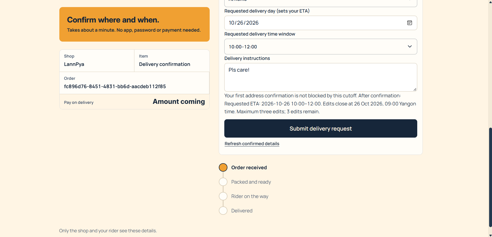

## 7. Buyer: check that the request was recorded

Wait for the green confirmation message. If the request requires dispatcher review, it has been submitted but still needs that review. Use **Edit my request** for an allowed later change.

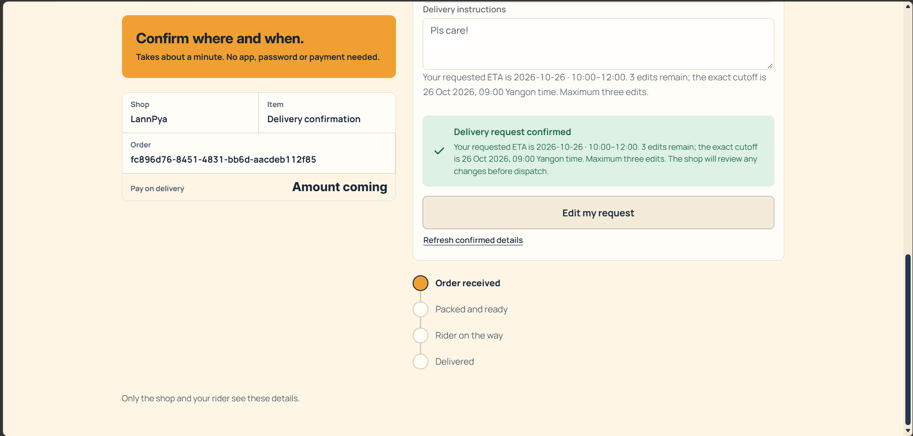

## 8. Dispatcher: review buyer changes when required

Return to **Service board** and open the order. The **Buyer requests awaiting review** area lists changes that require a decision, such as a delivery pin or instruction. Open each pending review, inspect the submitted change, choose the decision, and click **Save review**. The screenshots show separate pin and instruction reviews; resolve every required review before assignment can proceed.

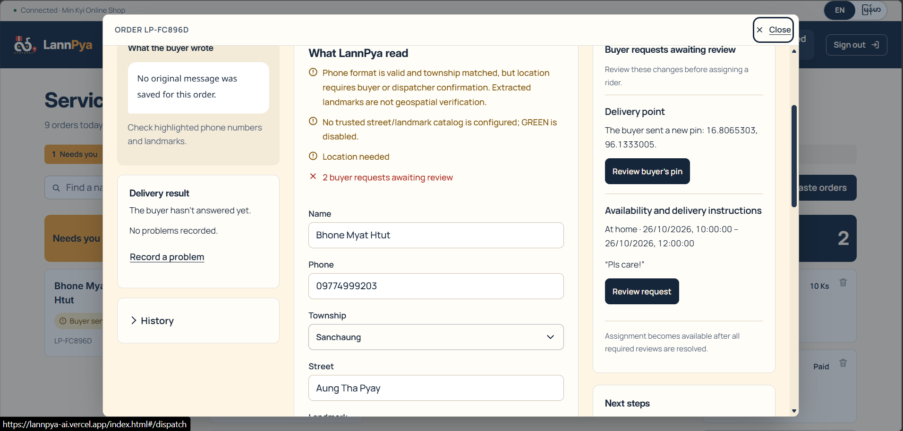

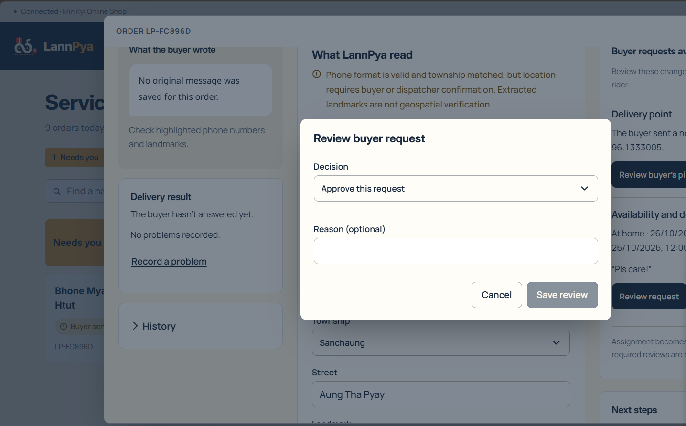

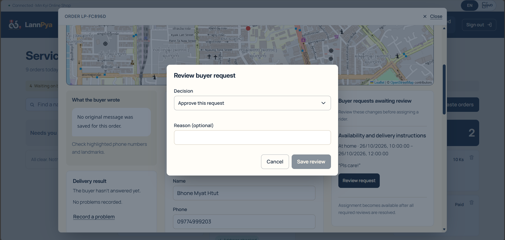

## 9. System: offer the delivery to an available rider

Once the parcel is at the hub and confirmation/review requirements are satisfied, the system can assign an available rider automatically. If the order displays **Reconfirm and find a rider**, use it after checking the outstanding requirements. If no rider is available, the order waits for availability.

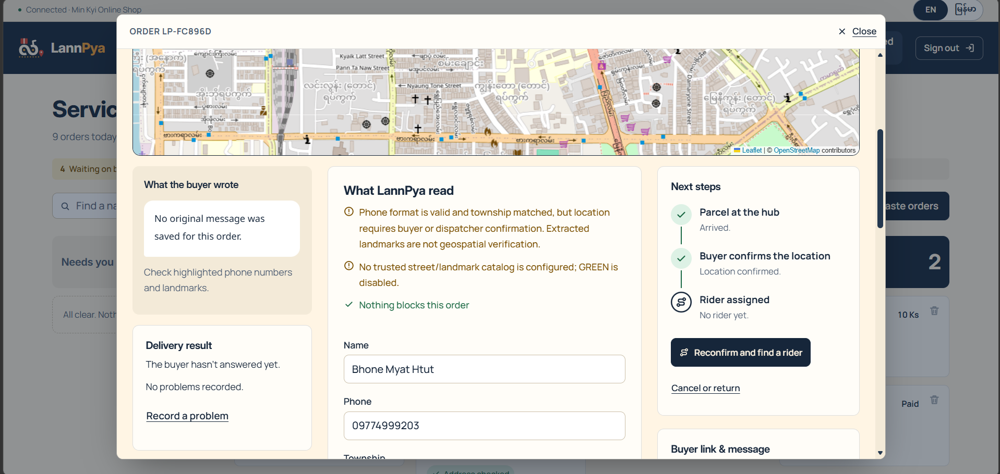

## 10. Rider: review and accept the offer

Sign in to the Rider portal. Check the buyer's address, requested time, notes, and collection amount. Choose **Accept offer** to take the delivery, or **Decline** if you cannot take it. Acceptance starts delivery automatically. There is no separate dispatcher dispatch action after acceptance; follow any parcel collection prompts shown by the rider screen.

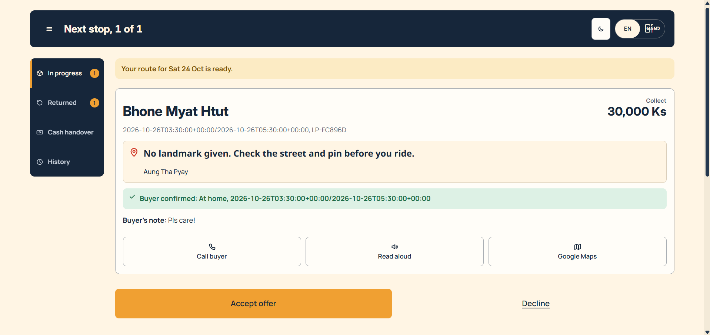

## 11. Dispatcher: monitor the accepted delivery

The order shows the assigned rider and its delivery progress. Use **Rider routes** to follow the rider's active route and **Service board → With rider** to find the order. An order that has left the hub has locked details; use its available problem or return actions when an exception occurs.

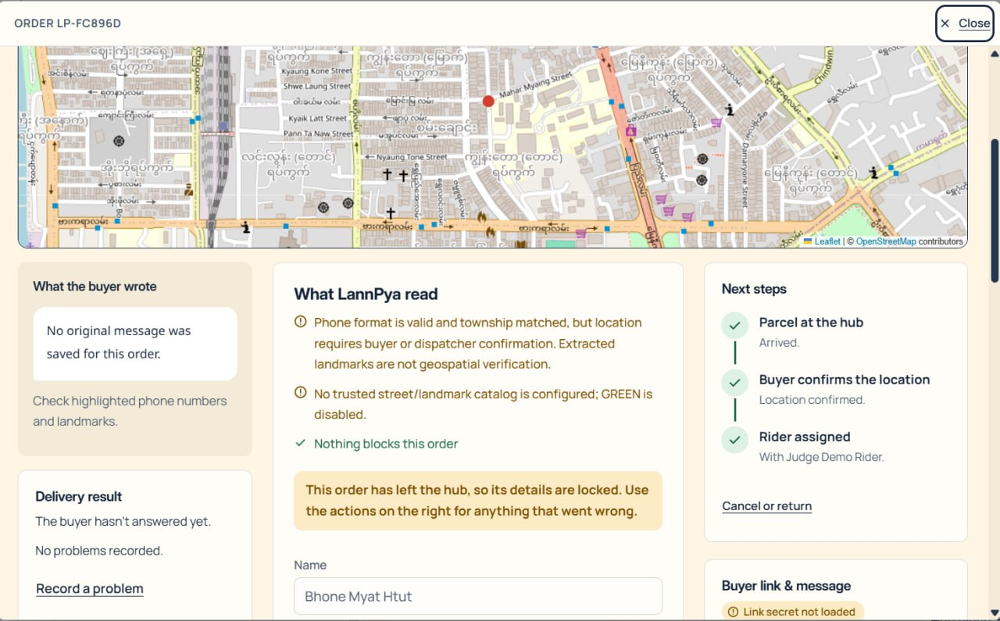

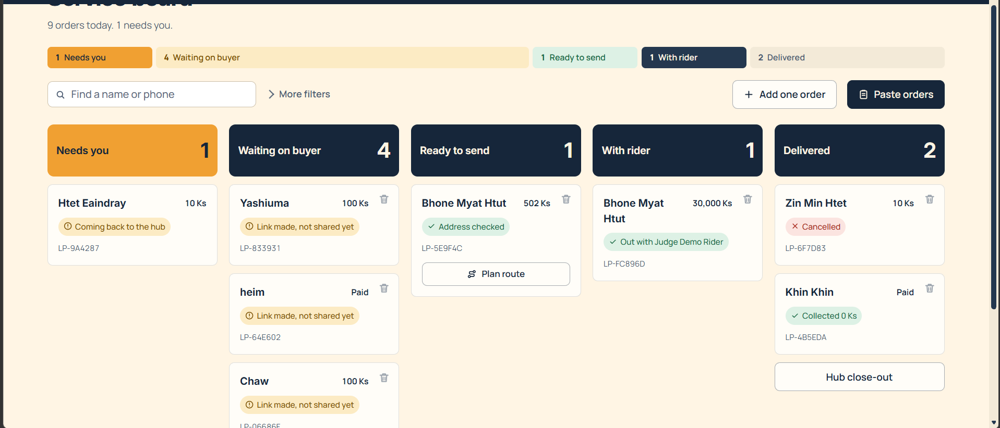

## 12. Rider: follow the map and complete the delivery

The rider map shows the current location and route to the destination when location and routing are available. Review the buyer's notes and the cash amount before arrival. Use **Call buyer** or the map controls as needed. After handing over the parcel, select **Delivered** and record any required collection details. Use **Can't deliver** to record an unsuccessful attempt and follow the offered resolution instead.

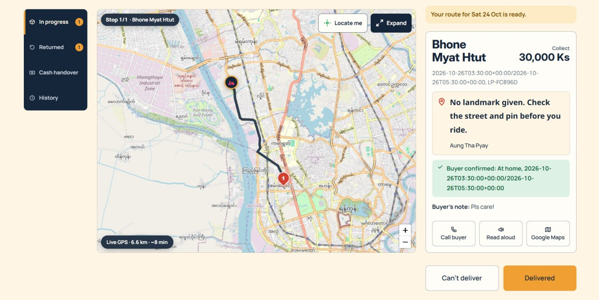

## 13. Rider and dispatcher: hand over and close the order

The supplied screenshots end while delivery is in progress. Finish the workflow in the app as follows:

1. The rider completes the delivery and records the actual cash collected, where applicable.
2. The rider opens **Cash handover** and submits the handover; physically return cash and any undelivered parcels to the hub.
3. The dispatcher checks and accepts the actual cash/parcel receipt, resolves any discrepancies, and closes the route when its remaining requirements are satisfied.
4. Confirm the completed delivery in the board/history. A successful doorstep delivery and the hub's financial/parcel close-out are separate steps.

## Screenshot files

All 17 supplied PNG/JPG images are included in [images/](images/). Spaces in filenames were changed to hyphens for readable repository links; image contents were preserved.
